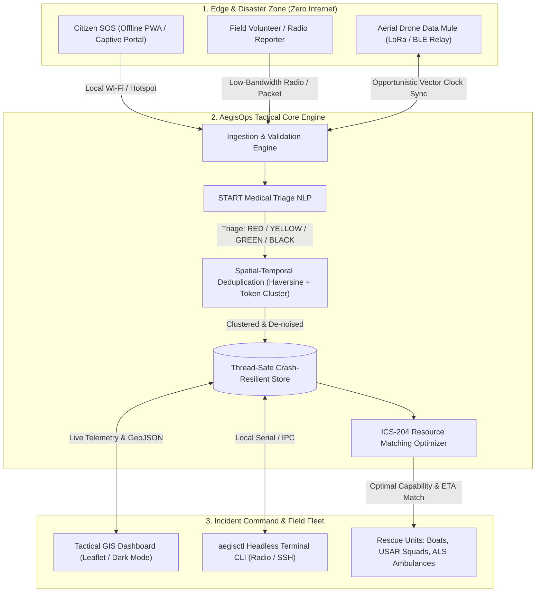

# AegisOps // Tactical Emergency Coordination & Mesh Operating System
> **Problem Statement #1:** Emergency Response Coordination After Disasters  
> **Team Vanguard** | Hackathon Round 1 Screening & Shortlisting

[](https://www.python.org/)
[](https://fastapi.tiangolo.com)
[]()
[]()
[]()
[](LICENSE)

---

## ⚡ The Executive Summary

When catastrophic disasters strike (cyclones, earthquakes, tsunamis), **cellular towers collapse, optical fiber breaks, and the power grid goes black**. 99% of modern emergency software—cloud web portals, WhatsApp helplines, and central 911 dispatch centers—fail instantly because they rely on continuous internet connectivity.

At the same time, emergency control centers face a **deadly information bottleneck**: responders are flooded with thousands of duplicate, unverified distress messages, leading to severe resource misallocation (e.g., sending boats to dry areas while victims trapped in submerged basements drown).

**AegisOps** is an **offline-first, delay-tolerant tactical coordination platform** engineered specifically for zero-connectivity disaster zones. It combines:
1. **Delay-Tolerant Networking (DTN):** Peer-to-peer opportunistic data syncing over local Wi-Fi, BLE, and LoRa radios using CRDT vector clocks.
2. **Automated START Medical Triage:** NLP extraction of vitals, trauma severity, and environmental hazard tags (flood water, gas leak, electrical hazards).
3. **Spatial-Temporal Deduplication:** Automatic clustering of redundant citizen reports within a 200m radius into single actionable master incidents.
4. **ICS-204 Resource Dispatch Optimizer:** Capability-aware matching of specialized fleet units (Ambulances, Zodiac swift boats, Heavy USAR squads, Drones) based on proximity, access, and survival windows.

---

## 🏛️ System Architecture



---

## 🚀 Key Innovations & Stand-Out Capabilities

| Feature | Typical Hackathon Project | AegisOps Innovation |
| :--- | :--- | :--- |
| **Connectivity** | Requires 100% active cloud/internet | **100% Offline-First:** Operates on isolated local hotspots, ad-hoc Wi-Fi, and LoRa packet radios via DTN. |
| **Triage Protocol** | Arbitrary star rating or basic keywords | **Official START Protocol:** Complies with international triage guidelines (Immediate Red, Delayed Yellow, Minor Green, Expectant Black). |
| **Deduplication** | None; all calls create separate tickets | **Geospatial & Semantic Clustering:** Automatically merges calls within 200m, aggregates victim counts, and eliminates alert fatigue. |
| **Dispatch Logic** | First-Come-First-Served list | **Capability-Aware Optimization:** Matches incident hazard profile to vehicle capabilities (e.g. Zodiac boats to rising water, USAR heavy squads to rubble). |
| **Adoption Barrier** | Requires installing native app before disaster | **Zero App Installation:** Operates via captive portal Wi-Fi (`RESCUE_SOS_WIFI`) on any modern smartphone browser. |
| **Interfaces** | Single web form | **Dual Interface:** High-density Tactical Web GIS for commanders + lightweight headless CLI (`aegisctl`) for field operators. |

---

## 📁 Repository Structure

```
hackton/
├── aegisops/                     # Core backend package
│   ├── __init__.py
│   ├── models.py                 # Pydantic schemas (Incidents, Units, Triage, MeshNodes)
│   ├── database.py               # Thread-safe in-memory store with state journaling
│   ├── triage.py                 # START protocol NLP classifier & hazard detector
│   ├── dedup.py                  # Spatial-temporal deduplication engine
│   ├── dispatch.py               # ICS-204 resource matching optimizer
│   ├── mesh_sync.py              # Delay-Tolerant Networking (DTN) sync protocol
│   └── api.py                    # FastAPI REST, GeoJSON & static file router
├── cli/
│   ├── __init__.py
│   └── aegisctl.py               # Command-line interface for field radio terminals
├── presentation/
│   ├── generate_deck.py          # Programmatic PPTX generator script
│   ├── PITCH_DECK_GUIDE.md       # Verbal 3-min pitch script & judge defense Q&A
│   └── AegisOps_Disaster_Coordination_Pitch.pptx  # Official 10-slide Round 1 deck
├── simulator/
│   └── seed_disaster.py          # Realistic 'Operation CoastalShield' simulation generator
├── static/
│   ├── index.html                # Tactical Incident Command GIS dashboard
│   ├── style.css                 # Dark military/ops theme styling
│   └── app.js                    # Leaflet map rendering & live telemetry polling
├── tests/
│   ├── test_triage.py            # START triage validation unit tests
│   ├── test_dedup.py             # Spatial clustering & deduplication tests
│   ├── test_dispatch.py          # Capability-aware resource dispatch tests
│   └── test_mesh_sync.py         # Vector clock store-and-forward sync tests
├── main.py                       # Root launcher
├── requirements.txt              # Production dependencies
└── README.md                     # Comprehensive project documentation
```

---

## 🛠️ Quickstart & Demonstration Guide

### 1. Installation
Clone the repository and install the lightweight requirements:
```bash
git clone https://github.com/vanguard-rescue/aegisops.git
cd aegisops

# Install dependencies
pip install -r requirements.txt
```

### 2. Run the Tactical Engine
Launch the server (preloaded automatically with the `Operation CoastalShield` disaster scenario):
```bash
python main.py
```
Open your browser at **`http://localhost:8000`** to access the live Tactical Command Dashboard.

### 3. Run the Automated Test Suite
Verify all 10 core algorithmic tests (Triage NLP, Deduplication, Dispatch, Mesh Sync):
```bash
python -m pytest -v
```

### 4. Field Terminal CLI (`aegisctl`) Examples
In a separate terminal, test the headless field CLI:
```bash
# View tactical system status & fleet readiness
python -m cli.aegisctl status

# Filter active incidents by Immediate (RED) triage
python -m cli.aegisctl list --triage RED

# Submit a raw field distress report (automatic NLP triage & hazard detection)
python -m cli.aegisctl report "Water rising waist high! 4 people trapped on roof, 1 unconscious!" --location "Fisherman Wharf Lane" --lat 12.8710 --lon 74.8450

# Execute automated ICS-204 resource dispatching
python -m cli.aegisctl dispatch
```

### 5. Generate / Regenerate Hackathon Presentation
```bash
python presentation/generate_deck.py
```
The output file `AegisOps_Disaster_Coordination_Pitch.pptx` will be created in the root directory.

---

## 🔬 In-Depth: The Core Engines

### 1. The START Medical Triage Engine (`triage.py`)
Follows the international **Simple Triage and Rapid Treatment (START)** guidelines:
- **IMMEDIATE (Priority 1 - RED):** Critical life threat (arterial hemorrhage, airway compromise, severe drowning, unconsciousness, trapped with rising water).
- **DELAYED (Priority 2 - YELLOW):** Serious trauma stable for 1–2 hours (bone fractures, diabetes/insulin cutoff, immobilization).
- **MINOR (Priority 3 - GREEN):** "Walking wounded", mild abrasions, basic shelter and food needs.
- **EXPECTANT / DECEASED (Priority 0 - BLACK):** Palliative / fatal trauma.

### 2. Spatial-Temporal Deduplication (`dedup.py`)
Calculates geographic distance via the great-circle Haversine formula:
$$d = 2R \arcsin\left(\sqrt{\sin^2\left(\frac{\Delta\phi}{2}\right) + \cos(\phi_1)\cos(\phi_2)\sin^2\left(\frac{\Delta\lambda}{2}\right)}\right)$$
If a new report falls within $r \le 200\text{ meters}$, temporal window $\Delta t \le 2\text{ hours}$, and token Jaccard similarity $J(A, B) \ge 0.35$, the incident is clustered as a duplicate of the master ticket. It updates the master ticket's survivor count ($\max(S_{\text{master}}, S_{\text{incoming}})$) and appends the witness text to the audit history without generating a duplicate dispatch ticket.

### 3. Capability-Aware ICS Dispatcher (`dispatch.py`)
Computes an assignment cost matrix across all active rescue units:
- Matches required capability: $\text{CapabilityMatch}(U_{\text{type}}, I_{\text{req}})$
- Minimizes Travel Time: $\text{ETA} = \left(\frac{\text{Distance}(\text{km})}{\text{Speed}(\text{km/h})}\right) \times 60$
- Enforces triage priority ordering: $P_{\text{RED}} \gg P_{\text{YELLOW}} \gg P_{\text{GREEN}}$.

---

## 🗺️ Offline Round 2 Roadmap
- [x] **Round 1 (Completed):** End-to-end software platform, START triage engine, ICS dispatcher, GIS dashboard, terminal CLI, test suite, and official presentation.
- [ ] **Physical Radio Hardware:** Direct serial bridge to ESP32 LoRa SX1262 transceiver modules for sub-GHz mesh broadcasting (868/915 MHz).
- [ ] **Offline Map Vector Tiles:** Embedded local vector mbtiles package providing full street-level zoom without external map tiles.
- [ ] **Thermal Drone Pipeline:** Computer vision survivor localization from low-altitude drone video feeds.

---

## 👥 Team & Submission Information
- **Problem Statement:** 1. Emergency Response Coordination After Disasters
- **Team Name:** Team Vanguard
- **Submission Date:** October 2026
- **License:** MIT Open Source
