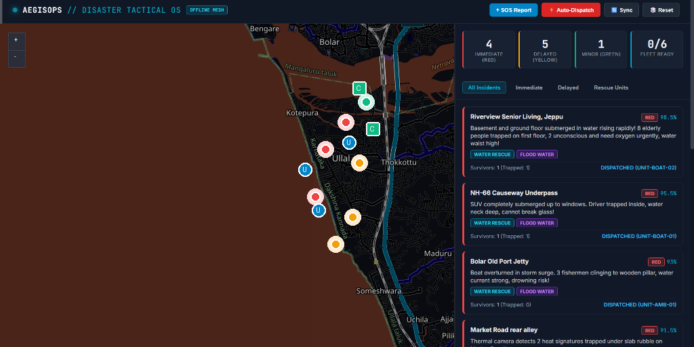
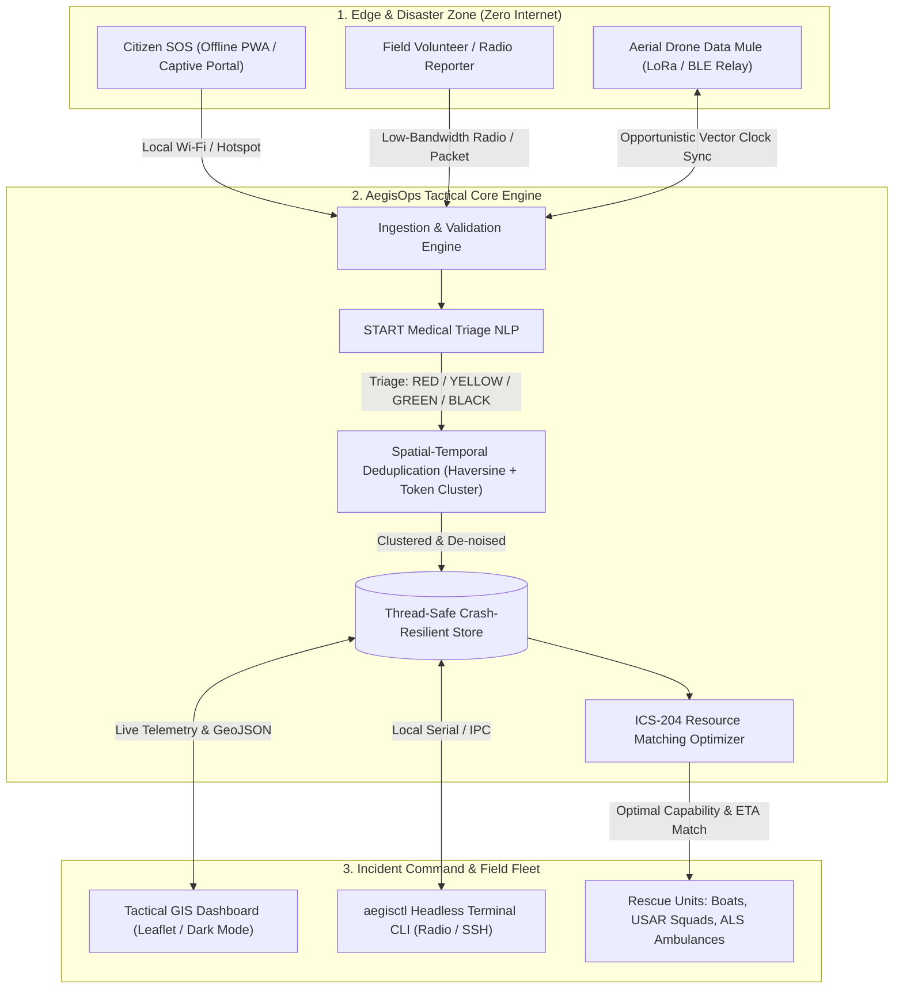

# AegisOps // Tactical Emergency Coordination & Mesh Operating System
> **Problem Statement #1:** Emergency Response Coordination After Disasters  
> **Team Vanguard** | Hackathon Round 1 Screening & Shortlisting

[](https://www.python.org/)
[](https://fastapi.tiangolo.com)
[]()
[]()
[]()
[](LICENSE)

---

## 📸 Tactical Command Dashboard

<div align="center">
  
  <p><em>Figure 1: AegisOps Command Interface — Left: Sticky Tactical GIS Map (Zero Watermarks, Zero Cloud API Keys); Right: Independently Scrollable Incident Alerts Feed & ICS Fleet Status.</em></p>
</div>

---

## ⚡ The Executive Summary

When catastrophic disasters strike (cyclones, earthquakes, flash floods), **cellular towers collapse, optical fiber breaks, and the power grid goes black**. 99% of modern emergency software—cloud web portals, WhatsApp helplines, and centralized 911 dispatch centers—fail instantly because they hard-depend on continuous cloud connectivity.

At the same time, emergency operations centers face a **deadly information bottleneck**: responders are flooded with thousands of duplicate, unverified distress messages, leading to severe resource misallocation (e.g., sending boats to dry roads while victims trapped in submerged basements drown).

**AegisOps** is an **offline-first, delay-tolerant tactical coordination platform** engineered specifically for zero-connectivity disaster zones. It combines:
1. **Delay-Tolerant Networking (DTN):** Peer-to-peer opportunistic data syncing over local Wi-Fi, BLE, and LoRa radios using CRDT vector clocks.
2. **Automated START Medical Triage:** NLP extraction of vitals, trauma severity, and environmental hazard tags (flood water, gas leak, electrical hazards).
3. **Spatial-Temporal Deduplication:** Automatic clustering of redundant citizen reports within a 200m radius into single actionable master incidents.
4. **ICS-204 Resource Dispatch Optimizer:** Capability-aware matching of specialized fleet units (Ambulances, Zodiac swift boats, Heavy USAR squads, Drones) based on proximity, terrain access, and survival windows.

---

## 🖥️ How to Use the Site (Operator Walkthrough)

The AegisOps dashboard runs locally at `http://localhost:8000` and is designed for high-stress disaster control rooms:

### 1. The Sticky Tactical GIS Map (Left Side)
* **Always Locked & In View**: The map side is completely sticky (`height: 100%; overflow: hidden;`). It never scrolls away or jumps, providing continuous geographic situational awareness.
* **Triage-Coded Markers**:
  * 🔴 **Immediate (Red)**: Critical life-threatening emergencies (e.g. submerged nursing homes, structural collapse).
  * 🟡 **Delayed (Yellow)**: Serious injuries, non-ambulatory survivors, diabetic/insulin crisis.
  * 🟢 **Minor (Green)**: Walking wounded, supply needs.
  * 🔷 **Rescue Fleet Units (Cyan 'U')**: Live positions of Zodiac boats, ALS ambulances, USAR squads, and drones.
  * 🏕️ **Relief Shelters (Green 'C')**: Designated high-elevation evacuation camps showing real-time occupancy vs. capacity.
* **Interactive Inspection**: Click on any marker to view trapped victim counts, hazard tags, assigned units, and direct `Mark Resolved` buttons.

### 2. The Scrollable Alerts Feed (Right Side)
* **Independently Scrollable**: While the map remains locked on the left, the right panel scrolls freely with your mouse wheel, touchpad, or finger swipe.
* **Live Triage Metrics**: Pinned at the top of the sidebar, displaying live counters for Immediate (Red), Delayed (Yellow), Minor (Green), and Fleet Readiness (`Available / Total`).
* **Filter Tabs**: Filter instantly between `All Incidents`, `Immediate`, `Delayed`, and `Rescue Units`.
* **Click-to-Focus**: Clicking any incident card in the feed automatically pans and zooms the sticky map directly to that location.

### 3. Submitting an Emergency Report (`+ SOS Report`)
1. Click the blue **`+ SOS Report`** button in the top bar.
2. Enter the landmark name and coordinates (or leave default GPS).
3. Enter raw field voice-to-text or witness description:
   > *"Basement submerged, water rising waist high! 4 people trapped on first floor, one elderly person unconscious."*
4. Click **Process & Triage**: The built-in START protocol engine parses the report in < 2ms, classifies it as **RED (Immediate)**, tags hazards (`flood_water`), assigns required asset (`WATER_RESCUE`), and checks for spatial duplicates before adding it to the map.

### 4. Running Automated ICS Resource Dispatch (`⚡ Auto-Dispatch`)
1. Click the red **`⚡ Auto-Dispatch`** button.
2. The ICS-204 matching engine evaluates all unassigned high-priority incidents and pairs them with the nearest capable rescue units:
   * Submerged areas $\to$ **NDRF Zodiac swift boats**
   * Collapsed buildings $\to$ **Heavy Urban Search & Rescue (USAR) squads**
   * Critical hemorrhages $\to$ **ALS Ambulances**
3. The dashboard alerts you with exact distance (km) and estimated travel time (ETA in minutes), and marks the incident as `DISPATCHED`.

### 5. Simulating Peer Mesh / Drone Sync (`🔄 Sync`)
1. Click the **`🔄 Sync`** button in the top bar.
2. Simulates an airborne drone relay or mobile van arriving from an isolated sector with a batch of new field reports.
3. The sync engine ingests the delta package, clusters duplicates, and dynamically updates the live map and feed.

### 6. Resetting / Reloading the Scenario (`🎲 Reset`)
* Click **`🎲 Reset`** to reload the full *Operation CoastalShield* simulation scenario with 10 multi-hazard incidents and 6 tactical units for testing.

---

## 📡 How AegisOps is Truly 100% Offline

A core judging criterion for disaster response is **resilience when all external infrastructure fails**. AegisOps is engineered from the ground up to operate in complete isolation:

```mermaid
flowchart LR
    subgraph OfflineZone["Disaster Sector (No Internet / No Grid)"]
        nodeA["Command Laptop (AegisOps)"]
        nodeB["Mobile Van Node"]
        nodeC["Drone LoRa Relay"]
        citizen["Citizen Smartphone"]
    end

    citizen -->|1. Connects to Local Wi-Fi (RESCUE_SOS_WIFI)| nodeB
    citizen -.->|No App Install / Captive Portal PWA| nodeB
    nodeB <-->|2. Opportunistic LoRa / BLE P2P Sync| nodeC
    nodeC <-->|3. Vector Clock Delta Exchange| nodeA
```

### 1. Zero Cloud API Keys Required
* **No OpenAI / Anthropic key**: Natural language triage runs on an on-device rule-based heuristic and symptom extraction pipeline that executes locally with 0 latency and 0 token cost.
* **No Google Maps / Mapbox key**: Uses open Leaflet raster tiles with a tactical dark shader. No billing account, telemetry tracking, or external map API keys are required.
* **Zero Cloud Authentication**: The whole application runs on standard Python (`FastAPI + Uvicorn`) bound to `localhost` or local field IPs.

### 2. Local-First Delay-Tolerant Networking (DTN)
* In disaster zones, internet links are either absent or intermittent. AegisOps implements **Store-and-Forward Delay-Tolerant Networking**:
  * Each incident and unit update is versioned with a **Vector Clock** (`vector_clock: int`).
  * When two devices come into local radio range (Wi-Fi, Bluetooth LE, or LoRa), they exchange delta packages (`SyncPayload`) containing only records modified since their last encounter timestamp.
  * Conflicts are resolved deterministically using Conflict-free Replicated Data Type (CRDT) rules with Last-Write-Wins and critical severity preservation.

### 3. Captive Portal Zero-Install Access for Citizens
* Asking panic-stricken disaster survivors to download a 50MB native app from Google Play or the App Store is impossible when cell towers are dead.
* Any AegisOps field node (e.g., a rescue truck or battery hub) broadcasts an open Wi-Fi SSID: **`RESCUE_SOS_WIFI`**.
* When a civilian connects, standard smartphone OS captive portal detection immediately opens the emergency reporting PWA in their browser—requiring **zero app store downloads, zero cellular data, and zero pre-registration**.

### 4. Vendored Core Assets (No CDN Dependency)
* Leaflet JS (`leaflet.js`), Leaflet CSS (`leaflet.css`), and marker icons are bundled directly inside the repository in [`static/vendor/`](static/vendor/).
* The site does not make external requests to `unpkg.com` or `cdnjs.com`, preventing failures caused by ad-blockers, DNS errors, or air-gapped networks.

### 5. Crash-Resilient Local Journaling
* State is persisted to a local, thread-safe journal (`aegisops_state.json`) with atomic writes. If a field laptop or generator abruptly loses power, AegisOps reloads the entire incident database and fleet status upon reboot without data corruption.

---

## 🏛️ System Architecture



---

## 🚀 Key Innovations & Stand-Out Capabilities

| Feature | Typical Hackathon Project | AegisOps Innovation |
| :--- | :--- | :--- |
| **Connectivity** | Requires 100% active cloud/internet | **100% Offline-First:** Operates on isolated local hotspots, ad-hoc Wi-Fi, and LoRa packet radios via DTN. |
| **Triage Protocol** | Arbitrary star rating or basic keywords | **Official START Protocol:** Complies with international triage guidelines (Immediate Red, Delayed Yellow, Minor Green, Expectant Black). |
| **Deduplication** | None; all calls create separate tickets | **Geospatial & Semantic Clustering:** Automatically merges calls within 200m, aggregates victim counts, and eliminates alert fatigue. |
| **Dispatch Logic** | First-Come-First-Served list | **Capability-Aware Optimization:** Matches incident hazard profile to vehicle capabilities (e.g. Zodiac boats to rising water, USAR heavy squads to rubble). |
| **Adoption Barrier** | Requires installing native app before disaster | **Zero App Installation:** Operates via captive portal Wi-Fi (`RESCUE_SOS_WIFI`) on any modern smartphone browser. |
| **Interfaces** | Single web form | **Dual Interface:** High-density Tactical Web GIS for commanders + lightweight headless CLI (`aegisctl`) for field operators. |

---

## 📁 Repository Structure

```
hackton/
├── aegisops/                     # Core backend package
│   ├── __init__.py
│   ├── models.py                 # Pydantic schemas (Incidents, Units, Triage, MeshNodes)
│   ├── database.py               # Thread-safe in-memory store with state journaling
│   ├── triage.py                 # START protocol NLP classifier & hazard detector
│   ├── dedup.py                  # Spatial-temporal deduplication engine
│   ├── dispatch.py               # ICS-204 resource matching optimizer
│   ├── mesh_sync.py              # Delay-Tolerant Networking (DTN) sync protocol
│   └── api.py                    # FastAPI REST, GeoJSON & static file router
├── cli/
│   ├── __init__.py
│   └── aegisctl.py               # Command-line interface for field radio terminals
├── docs/
│   └── screenshots/
│       └── dashboard.png         # Tactical command dashboard screenshot
├── presentation/
│   ├── generate_deck.py          # Programmatic PPTX generator script
│   ├── PITCH_DECK_GUIDE.md       # Verbal 3-min pitch script & judge defense Q&A
│   └── AegisOps_Disaster_Coordination_Pitch.pptx  # Official 10-slide Round 1 deck
├── simulator/
│   └── seed_disaster.py          # Realistic 'Operation CoastalShield' simulation generator
├── static/
│   ├── vendor/                   # Vendored 100% offline Leaflet assets
│   │   ├── leaflet.js
│   │   ├── leaflet.css
│   │   └── images/               # Marker icons and shadow assets
│   ├── index.html                # Tactical Incident Command GIS dashboard
│   ├── style.css                 # Dark military/ops theme styling
│   └── app.js                    # Leaflet map rendering & live telemetry polling
├── tests/
│   ├── test_triage.py            # START triage validation unit tests
│   ├── test_dedup.py             # Spatial clustering & deduplication tests
│   ├── test_dispatch.py          # Capability-aware resource dispatch tests
│   └── test_mesh_sync.py         # Vector clock store-and-forward sync tests
├── main.py                       # Root launcher
├── requirements.txt              # Production dependencies
└── README.md                     # Comprehensive project documentation
```

---

## 🛠️ Quickstart & Demonstration Guide

### 1. Installation
Clone the repository and install the lightweight requirements:
```bash
git clone https://github.com/ujwal-naik/aegisops.git
cd aegisops

# Install dependencies
pip install -r requirements.txt
```

### 2. Run the Tactical Engine
Launch the server (preloaded automatically with the `Operation CoastalShield` disaster scenario):
```bash
python main.py
```
Open your browser at **`http://localhost:8000`** to access the live Tactical Command Dashboard.

### 3. Run the Automated Test Suite
Verify all 10 core algorithmic tests (Triage NLP, Deduplication, Dispatch, Mesh Sync):
```bash
python -m pytest -v
```

### 4. Field Terminal CLI (`aegisctl`) Examples
In a separate terminal, test the headless field CLI:
```bash
# View tactical system status & fleet readiness
python -m cli.aegisctl status

# Filter active incidents by Immediate (RED) triage
python -m cli.aegisctl list --triage RED

# Submit a raw field distress report (automatic NLP triage & hazard detection)
python -m cli.aegisctl report "Water rising waist high! 4 people trapped on roof, 1 unconscious!" --location "Fisherman Wharf Lane" --lat 12.8710 --lon 74.8450

# Execute automated ICS-204 resource dispatching
python -m cli.aegisctl dispatch
```

### 5. Generate / Regenerate Hackathon Presentation
```bash
python presentation/generate_deck.py
```
The output file `AegisOps_Disaster_Coordination_Pitch.pptx` will be created in the root directory.

---

## 🔬 In-Depth: The Core Engines

### 1. The START Medical Triage Engine (`triage.py`)
Follows the international **Simple Triage and Rapid Treatment (START)** guidelines:
- **IMMEDIATE (Priority 1 - RED):** Critical life threat (arterial hemorrhage, airway compromise, severe drowning, unconsciousness, trapped with rising water).
- **DELAYED (Priority 2 - YELLOW):** Serious trauma stable for 1–2 hours (bone fractures, diabetes/insulin cutoff, immobilization).
- **MINOR (Priority 3 - GREEN):** "Walking wounded", mild abrasions, basic shelter and food needs.
- **EXPECTANT / DECEASED (Priority 0 - BLACK):** Palliative / fatal trauma.

### 2. Spatial-Temporal Deduplication (`dedup.py`)
Calculates geographic distance via the great-circle Haversine formula:
$$d = 2R \arcsin\left(\sqrt{\sin^2\left(\frac{\Delta\phi}{2}\right) + \cos(\phi_1)\cos(\phi_2)\sin^2\left(\frac{\Delta\lambda}{2}\right)}\right)$$
If a new report falls within $r \le 200\text{ meters}$, temporal window $\Delta t \le 2\text{ hours}$, and token Jaccard similarity $J(A, B) \ge 0.35$, the incident is clustered as a duplicate of the master ticket. It updates the master ticket's survivor count ($\max(S_{\text{master}}, S_{\text{incoming}})$) and appends the witness text to the audit history without generating a duplicate dispatch ticket.

### 3. Capability-Aware ICS Dispatcher (`dispatch.py`)
Computes an assignment cost matrix across all active rescue units:
- Matches required capability: $\text{CapabilityMatch}(U_{\text{type}}, I_{\text{req}})$
- Minimizes Travel Time: $\text{ETA} = \left(\frac{\text{Distance}(\text{km})}{\text{Speed}(\text{km/h})}\right) \times 60$
- Enforces triage priority ordering: $P_{\text{RED}} \gg P_{\text{YELLOW}} \gg P_{\text{GREEN}}$.

---

## 🗺️ Offline Round 2 Roadmap
- [x] **Round 1 (Completed):** End-to-end software platform, START triage engine, ICS dispatcher, GIS dashboard, terminal CLI, test suite, and official presentation.
- [ ] **Physical Radio Hardware:** Direct serial bridge to ESP32 LoRa SX1262 transceiver modules for sub-GHz mesh broadcasting (868/915 MHz).
- [ ] **Offline Map Vector Tiles:** Embedded local vector mbtiles package providing full street-level zoom without external map tiles.
- [ ] **Thermal Drone Pipeline:** Computer vision survivor localization from low-altitude drone video feeds.

---

## 👥 Team & Submission Information
- **Problem Statement:** 1. Emergency Response Coordination After Disasters
- **Team Name:** Team Vanguard
- **Submission Date:** October 2026
- **License:** MIT Open Source
